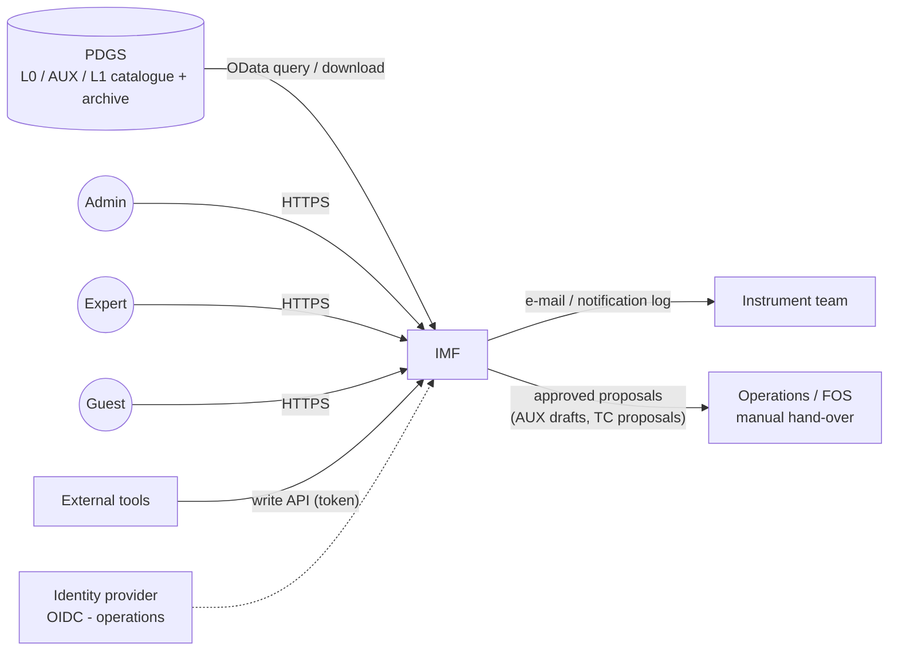
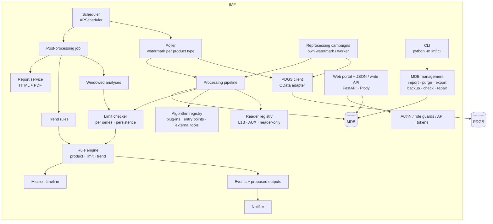
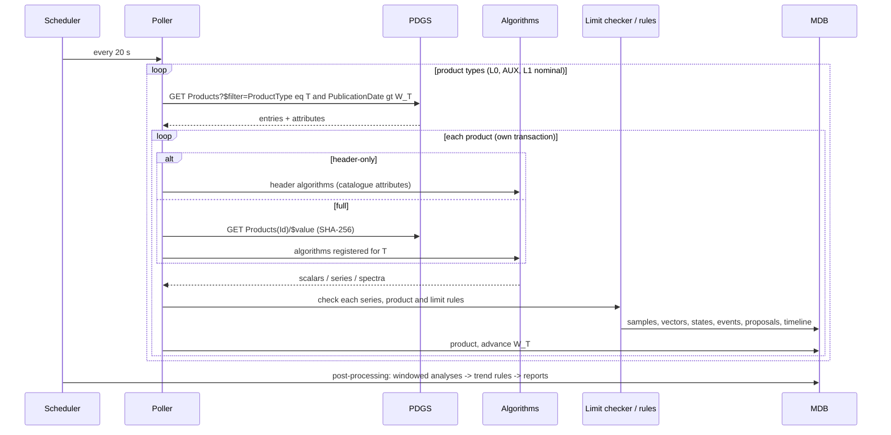
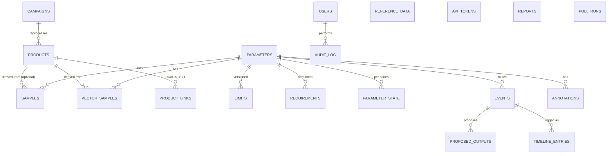

# IMF – Architecture and Design

## 1. Purpose and scope

The Instrument Monitoring Facility (IMF) continuously assesses the health and performance of
the instrument from its L0 headers, auxiliary data and Level-1 products. It

* retrieves new products of all configured types from the Payload Data Ground Segment (PDGS),
* derives monitoring parameters (scalars, series per sub-band / direction / sensor, spectra) and
  archives them in the monitoring database (MDB) with full traceability,
* analyses data across products and over time windows (L0→L1 completeness, ZPD versus ancillary
  data, requirement compliance),
* detects limit violations and rule conditions, raises / notifies events, recommends actions and
  drafts the corresponding outputs for expert approval,
* maintains a mission timeline generated from the PDGS data,
* processes reprocessing campaigns in parallel to the nominal operation,
* produces periodic reports with trend plots, and
* gives admins, instrument experts, guests and external tools role-dependent access to all of this.

This prototype implements the full chain for a Fourier-Transform Spectrometer, using a PDGS
simulator as data source. The mapping of the feature requests onto this design is documented in
[feature_gap_analysis.md](feature_gap_analysis.md).

## 2. Context

There is no interface to the FOS: the IMF never sends telecommands or files itself.

## 3. Components

| Component | Module | Responsibility |
|---|---|---|
| PDGS client | `imf/ingestion/pdgs_client.py` | Catalogue query per product type (`PublicationDate gt <watermark>`, optional baseline attribute filter, `$expand=Attributes`), download with SHA-256, retry with back-off. Only component that knows the PDGS interface. |
| Poller | `imf/ingestion/poller.py` | Polls all configured product types (L0 and auxiliary data first, then L1 of the nominal baseline), one watermark per type, skips known products, one DB transaction per product. Header-only types are not downloaded. Failed products are stored as FAILED and do not block the chain. |
| Reprocessing campaigns | `imf/ingestion/campaigns.py` | Ingest another baseline over the mission or a period, with their own watermark, in a worker thread or a separate process (`imf.cli campaign run`). |
| Reader registry | `imf/processing/readers.py`, `l1reader.py` | One reader per product type (L1B and AUX_ANC as HDF5; header-only products as catalogue attributes). A real ICD replaces only its reader. |
| Algorithm registry | `imf/processing/registry.py` | `@algorithm("CODE", ..., inputs=(types))`; results are floats, `Dim` (series values) or `Vector` (spectra). Plug-ins from built-in modules, `processing.plugin_modules`, entry points `imf.algorithms`, and external executables (JSON contract). Name and version are stored as the source of each sample. |
| Algorithms | `fts_algorithms.py`, `aux_algorithms.py` | NESR (deep space, index per sub-band and direction, spectral), transmission, gain drift, ice, spectral shift, ILS, ISRF feature, SSD, laser, ZPD, interferogram, reference/science delay, temperatures (incl. two bench sensor types), quality flags, geometry; L0 header and ancillary parameters. |
| Windowed analyses | `imf/processing/analyses.py`, `fts_analyses.py` | Per day (data time), once all input types are complete: L0→L1 completeness, product links and timeline gaps; ZPD (L1) versus ancillary turn-around positions and fringe counter; SSD requirement compliance. Per baseline. |
| Limit checker | `imf/monitoring/limits.py` | Classifies each sample, confirms level changes after *N* consecutive samples per series (parameter, baseline, dims), opens and clears events. |
| Rule engine | `imf/monitoring/rules.py`, `fts_rules.py` | Product, limit and trend rules (E1–E6). Attaches recommended actions and generates proposed outputs (values, files, telecommand proposals). Nominal baseline only. |
| Mission timeline | `imf/monitoring/timeline.py` | Data gaps, L1 processing gaps, calibration modes, anomalies, actions, campaigns; manual, imported and external entries. |
| Notifier | `imf/monitoring/notifier.py` | Notification log + optional SMTP, including recommended actions. |
| Report service | `imf/reporting/` | Data-time-driven scheduling, statistics per parameter, requirement compliance, actions, timeline, NESR versus template, trend plots; HTML and PDF. |
| MDB management | `imf/mdb.py`, `imf/cli.py` | Manual parameters and values, CSV imports (samples, timeline, reference data), purge, export, backup / restore, check, repair, API tokens. |
| Migrations | `imf/migrate.py`, `imf/migrations/` | Alembic revisions, applied at start-up; prototype databases are stamped and upgraded. |
| Web portal / API | `imf/web/` | Dashboard, parameters (series, spectra, requirements), explorer with baseline selector, map, timeline, products, events with approval of proposed outputs, reports, administration; JSON API and write API `/api/v1` (OpenAPI at `/api/docs`). |

## 4. Data flow

Time handling: all monitoring is based on **data (sensing) time**, not wall-clock time. Plots, time
windows, analysis windows, trend evaluation steps and periodic reports are anchored at the data
time. Backlog ingestion, live operation and reprocessing therefore produce identical results.

## 5. Monitoring database

* **Products** carry level (L0 / L1 / AUX), baseline, processor and product version, SHA-256 and
  header attributes. Only the checksum of a downloaded product is kept (`keep_products: false`).
* **Samples** (parameter, product, time, value, level, dims, baseline, entry type, source, entry
  time) form the time-series table, indexed on (parameter, time). Manual, imported and external
  samples have no product. In operations: PostgreSQL + TimescaleDB hypertable.
* **Series**: `dims` (e.g. `dir=fwd;sb=3`) identifies a series of a parameter. Limits apply to all
  series of a parameter, the persistence state is kept per (parameter, baseline, dims).
* **Baselines**: L1-derived data carries its processing baseline. L0, auxiliary and manual data are
  baseline-independent (`""`) and appear in every baseline view. Rules act on the nominal baseline only.
* **Vector samples** store spectra and profiles (axis + values, JSON).
* `limits` and `requirements` are **versioned** (never updated in place): who changed what, when and why.
* Full traceability: samples, vectors and events reference their source product; analysis outputs
  reference their analysis, and proposed outputs reference their event and rule.
* Schema changes are Alembic migrations (`imf/migrations/versions`).

## 6. Events

| Item | Behaviour |
|---|---|
| Categories | **limit** (limit violation), **action** (rule condition with recommended action and proposed outputs), **timeline** (informational, e.g. calibration mode) |
| Levels | INFO / WARNING (soft limit) / ALARM (hard limit), low and high limits |
| Persistence | Level change confirmed after *N* consecutive samples (per series) |
| Escalation | WARNING → ALARM opens a new ALARM event |
| Clearing | Back to nominal (with persistence) sets the *cleared* time; trend rules clear with hysteresis |
| Lifecycle | OPEN → ACKNOWLEDGED (expert, with comment) → CLOSED once acknowledged and cleared |
| Proposed outputs | DRAFT → APPROVED / REJECTED by an expert (audited); files are kept with SHA-256 |
| Notification | On raise and clear (with the recommended action); minimum severity configurable; INFO not notified |

| Rule | Kind | Trigger | Proposed output |
|---|---|---|---|
| E1 | product | AUX_EFSI product | Timeline entry "special calibration mode" |
| E2 | limit | `SPEC_SHIFT` threshold | New visible laser wavenumber (value) |
| E3 | limit | `ISRF_FEATURE` threshold | Radiometric scaling of the ISRF (value) |
| E4 | limit | `REF_SCI_DELAY` threshold | Complex transfer function update (CSV) |
| E5 | trend | `ZPD_OFFSET` slope | Telecommand proposal FTS_SET_ZPD_OFFSET (JSON) |
| E6 | trend | `NESR_IDX_MEAN` slope | Draft NESR AUX file (HDF5) from the orbit-averaged spectral NESR |

Trend rules use a robust Theil–Sen slope over a sliding window, evaluated in fixed data-time steps.
They need confirmation over consecutive steps, clear with hysteresis, and exclude samples that
already violate a limit, because excursions are handled by limit events.

## 7. Users and roles

| Capability | Guest | Expert | Admin | API token |
|---|:-:|:-:|:-:|:-:|
| Dashboard, public parameters, map, timeline, published reports | ✔ | ✔ | ✔ | |
| All parameters, products, events, CSV / MDB export | | ✔ | ✔ | |
| Acknowledge events, approve proposed outputs, annotations, manual values, timeline entries, ad-hoc reports | | ✔ | ✔ | |
| Limits, requirements, visibility, users, campaigns, imports, purge, backup, repair, tokens, jobs, audit log | | | ✔ | |
| Write samples / spectra / timeline entries (`/api/v1`) | | ✔ | ✔ | ✔ (expert / admin token) |
| Create parameters via API | | | ✔ | ✔ (admin token) |

Access control is enforced server-side for both pages and API (FastAPI dependencies);
the UI merely hides what is not accessible. Role/active state is re-validated on every request.
All security-relevant actions are written to the audit log. API tokens are stored as SHA-256 hashes.

## 8. Configuration

`config/imf.yaml` (validated with pydantic) contains:

* PDGS endpoint, product types (level, header / full mode), nominal baseline and polling;
* database URL, reporting schedule, notification;
* processing directories, plug-in modules and external tools;
* seed users, instrument characterisation data, reference data files and rule parameters;
* the parameter catalogue with initial limits, requirements, series dimensions and kind.

Parameter definitions are configuration-controlled. Limits, requirements and visibility are
subsequently maintained by administrators in the DB.

## 9. Prototype vs. operational deployment

| Aspect | Prototype | Operational proposal |
|---|---|---|
| PDGS interface | Simulator, OData-like (L0 headers, AUX, L1 in two baselines) | ICD-compliant adapter (e.g. PRIP / CDSE OData), authentication, checksums |
| Database | SQLite (WAL) with Alembic migrations | PostgreSQL + TimescaleDB, backups (`pg_dump` via the CLI), HA |
| Processing | In-process; campaigns in a thread or a separate CLI process | Worker pool / queue for re-processing campaigns, containerised |
| Authentication | Local accounts (scrypt), API tokens | SSO via OIDC (Keycloak federated with agency IdP), MFA |
| Deployment | `run_demo.py`, single container ([DOCKER.md](../DOCKER.md)) | Compose / Kubernetes: `imf-web`, `imf-worker`, PostgreSQL, reverse proxy with TLS, monitoring of the IMF itself |
| Notifications | Log file (SMTP optional) | E-mail, ticketing / anomaly-report system integration |
| Reports | HTML + PDF | + configurable templates, report sign-off workflow |
| Algorithms | Python plug-ins, entry points, external executables | Configuration-controlled, validated against reference data, versioned with re-processing |

## 10. Extension points

* **New parameter**: write an `@algorithm` function (or an external tool), add the parameter to the
  YAML. Use `Dim` for series and `Vector` for spectra.
* **New input type**: add the product type to `pdgs.product_types` and register a reader (or use
  header mode); declare the type in the algorithms' `inputs`.
* **New analysis**: `@analysis("CODE", inputs=(...))` in a plug-in module, evaluated per day.
* **New rule**: `@rule("CODE", "product" | "limit" | "trend", ...)`; parameters in the `rules:` configuration.
* **External tools**: Python packages via the entry-point groups `imf.algorithms`, `imf.rules`,
  `imf.analyses`; executables via `processing.external_tools`; any language via the write API `/api/v1`.
* **New mission / instrument**: new readers + algorithm / rule modules, same core.
