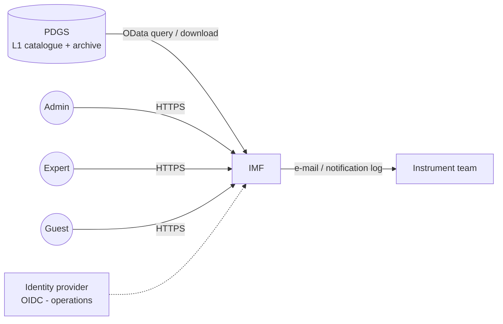
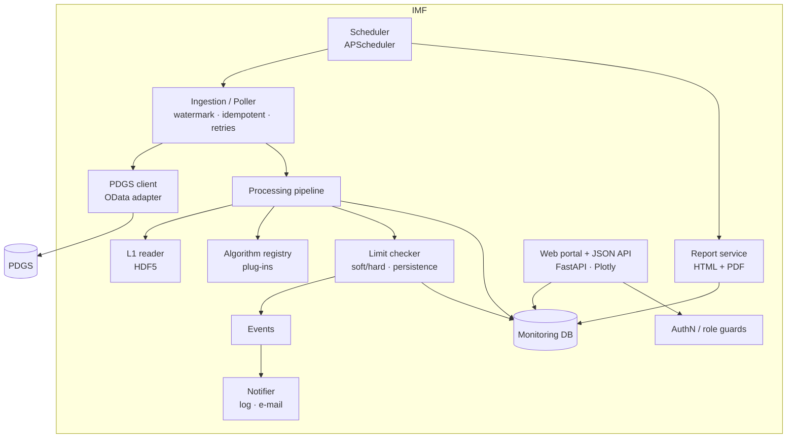
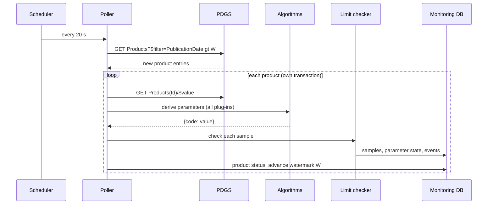
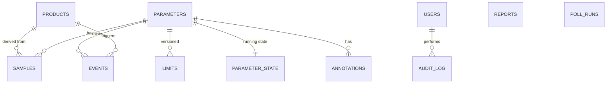

# IMF – Architecture and Design

## 1. Purpose and scope

The Instrument Monitoring Facility (IMF) continuously assesses the health and performance of
the instrument from its Level-1 data. It

* retrieves new L1 products from the Payload Data Ground Segment (PDGS),
* derives monitoring parameters and archives them in a monitoring database,
* detects limit violations and raises/notifies events,
* produces periodic reports with trend plots, and
* gives admins, instrument experts and guests role-dependent web access to all of this.

This prototype implements the full chain for a Fourier-Transform Spectrometer, using a PDGS
simulator as data source.

## 2. Context

## 3. Components

| Component | Module | Responsibility |
|---|---|---|
| PDGS client | `imf/ingestion/pdgs_client.py` | Catalogue query (`PublicationDate gt <watermark>`), download, retry with back-off. Only component that knows the PDGS interface. |
| Poller | `imf/ingestion/poller.py` | Pages through new products, skips known ones, one DB transaction per product, records each polling run. Failed products are stored as FAILED and do not block the chain. |
| L1 reader | `imf/processing/l1reader.py` | Isolates algorithms from the product format. |
| Algorithm registry | `imf/processing/registry.py` | `@algorithm("CODE", ...)` decorator; new parameters = new function, no pipeline change. Algorithm name + version stored per parameter. |
| FTS algorithms | `imf/processing/fts_algorithms.py` | NESR, gain drift, ice contamination, spectral shift, ILS, laser drift, interferogram/ZPD/scan speed, temperatures, data quality, co-registration. |
| Limit checker | `imf/monitoring/limits.py` | Classifies each sample (nominal / warning / alarm), confirms level changes after *N* consecutive samples (persistence = hysteresis), opens / clears events. |
| Notifier | `imf/monitoring/notifier.py` | Notification log + optional SMTP; extensible (e.g. ticketing, chat). |
| Report service | `imf/reporting/` | Data-time-driven scheduling (a period is reported once complete), statistics, events, trend plots; self-contained HTML and PDF. |
| Web portal / API | `imf/web/` | Dashboard, parameter browser, explorer, products, events, reports, administration; JSON API (OpenAPI at `/api/docs`). |

## 4. Data flow per product

Time handling: all monitoring is based on **data (sensing) time**, not wall-clock time. Plots,
time windows and periodic reports are anchored at the latest sensing time, which makes
re-processing and backlog ingestion produce identical results.

## 5. Monitoring database

* `samples` (parameter, product, time, value, level) is the time-series table – indexed on
  (parameter, time). In operations: PostgreSQL + TimescaleDB hypertable, continuous aggregates
  for long-range plots, retention/compression policies.
* `limits` are **versioned** (never updated in place): who changed what, when and why.
* Full traceability: every sample and event references the source product.

## 6. Events

| Item | Behaviour |
|---|---|
| Levels | NOMINAL / WARNING (soft limit) / ALARM (hard limit), low and high limits |
| Persistence | Level change confirmed after *N* consecutive samples (per parameter) |
| Escalation | WARNING → ALARM opens a new ALARM event |
| Clearing | Back to nominal (with persistence) sets *cleared* time |
| Lifecycle | OPEN → ACKNOWLEDGED (expert, with comment) → CLOSED once acknowledged and cleared |
| Notification | On raise and clear; minimum severity configurable |

## 7. Users and roles

| Capability | Guest | Expert | Admin |
|---|:-:|:-:|:-:|
| Dashboard, public parameters, published reports | ✔ | ✔ | ✔ |
| All parameters, products, event details, CSV export | | ✔ | ✔ |
| Acknowledge events, annotations, ad-hoc reports | | ✔ | ✔ |
| Limits, parameter visibility, users, publish reports, trigger jobs, audit log | | | ✔ |

Access control is enforced server-side for both pages and API (FastAPI dependencies);
the UI merely hides what is not accessible. Role/active state is re-validated on every request.
All security-relevant actions are written to the audit log.

## 8. Configuration

`config/imf.yaml` (validated with pydantic): PDGS endpoint and polling, database URL,
reporting schedule, notification, seed users, instrument characterisation data and the
parameter catalogue with initial limits. Parameter definitions are configuration-controlled;
limits and visibility are subsequently maintained by administrators in the DB.

## 9. Prototype vs. operational deployment

| Aspect | Prototype | Operational proposal |
|---|---|---|
| PDGS interface | Simulator, OData-like | ICD-compliant adapter (e.g. PRIP / CDSE OData), authentication, checksums |
| Database | SQLite | PostgreSQL + TimescaleDB, backups, HA |
| Processing | In-process, sequential | Worker pool / queue for re-processing campaigns, containerised |
| Authentication | Local accounts (scrypt) | SSO via OIDC (Keycloak federated with agency IdP), MFA |
| Deployment | `run_demo.py` | Docker / Kubernetes, reverse proxy with TLS, monitoring of the IMF itself |
| Notifications | Log file (SMTP optional) | E-mail, ticketing / anomaly-report system integration |
| Reports | HTML + PDF | + configurable templates, report sign-off workflow |
| Algorithms | Python plug-ins | Configuration-controlled, validated against reference data, versioned with re-processing |

## 10. Extension points

* **New parameter**: write an `@algorithm` function, add the parameter to the YAML.
* **New mission/instrument**: new L1 reader + algorithm module, same core.
* **Other data sources** (L0 housekeeping, auxiliary data): additional ingestion adapters
  feeding the same parameter/sample model.
* **Derived analyses**: correlations, long-term trend fitting, prediction of limit crossings
  (e.g. "ice loss will reach the alarm limit in ~12 days" – decontamination planning).
