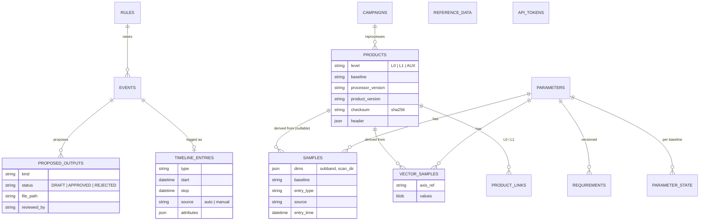
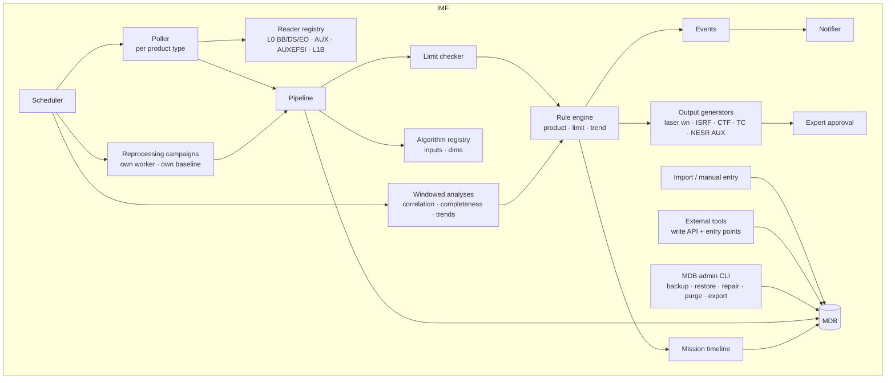

# IMF – Feature-request gap analysis and extension roadmap

Source: `feature_request.txt` (commit `4b39d10`). Baseline: the prototype described in
[architecture.md](architecture.md).

This document maps every requested monitoring item (M1–M10), requirement (R1–R11) and event (E1–E6)
onto the current design. For each one it states what is missing and proposes a design extension and
an implementation phase. It also assesses the externally provided `Dockerfile` (section 8).

**Decisions taken for this analysis**

* **Input formats.** No ICDs exist yet for L0 (black body, deep space, earth view), ancillary data
  or AUXEFSI. Plausible synthetic layouts are assumed and generated by `pdgs_sim`. Every format is
  isolated behind a reader per product type, so a real ICD replaces only that reader.
* **Events.** The IMF detects the condition and raises an event with a recommended action. Where
  possible it also **generates the proposed output** (a value or an AUX file). An expert must
  approve it, and the IMF never sends anything to the satellite or the FOS.

---

## 1. Current design – constraints relevant to the requests

| Aspect | Today | Where |
|---|---|---|
| Inputs | One product type (`FTS_L1B`), one OData query, one HDF5 reader | `config/imf.yaml` (`pdgs.product_type`), `imf/ingestion/pdgs_client.py`, `imf/processing/l1reader.py` |
| Algorithms | `fn(L1Product, ctx) -> dict[str, float]`: one scalar per parameter and product. Modules come from a fixed list | `imf/processing/registry.py` (`PLUGIN_MODULES`), `imf/processing/fts_algorithms.py` |
| Samples | `(parameter, product, time, value, level)`. `product_id` is mandatory. No entry type, source, entry time or baseline | `imf/models.py` – `Sample` |
| Products | No processing level, baseline, processor or product version, or checksum. `processor_version` exists in the HDF5 attributes but is not stored | `imf/models.py` – `Product`, `pdgs_sim/generator.py` |
| Events | Raised only by limit violations. `parameter_id` and the WARNING/ALARM severity are mandatory. No rule type, no action | `imf/models.py` – `Event`, `imf/monitoring/limits.py` – `check_sample` |
| Timeline | None. `Annotation` (free text per parameter) is the closest concept | `imf/models.py` – `Annotation` |
| Processing | Sequential and in-process, with a single watermark (`poll.watermark`). One global `ParameterState` per parameter | `imf/ingestion/poller.py`, `imf/monitoring/limits.py` |
| Schema evolution | `Base.metadata.create_all`. No migrations | `imf/db.py` |
| Export | CSV per parameter only | `imf/web/api.py` – `export_csv` |

**Strengths to keep and reuse**

* **Data-time anchoring.** All monitoring uses sensing time, so replays are deterministic. This is
  the basis for reprocessing (R7) and repair (R11).
* **Plug-in isolation and per-product transactions.** A failing algorithm or product does not stop
  the chain (`Pipeline.derive`, `Poller._handle`).
* **Versioned, audited limits** (`Limit`, `AuditLog`). The same pattern applies to requirements,
  timeline entries and proposed outputs.
* **The `@algorithm` decorator.** It is extended (with inputs and dimensions), not replaced.

---

## 2. Monitoring items

Status: ✔ covered · ◐ partial · ✘ gap

| # | Requested item | Status | Gap | Design extension | Phase |
|---|---|:-:|---|---|:-:|
| M1 | Catalogue of nominal L0 data: header information of black body, deep space and earth products, plus ancillary data | ✘ | Only `FTS_L1B` is queried. No header-only ingestion | A list of product types in the configuration. Each type has `mode: header \| full` and its own reader. Header fields are stored in `Product.header` (JSON). Header algorithms (number of views per type, duration, gaps) produce parameters per product type | 2 |
| M2 | Catalogue of nominal L1 data: could L0 be processed to L1? | ✘ | No link between products of different levels | An **L0↔L1 matching job** (by orbit or sensing-time overlap). It sets `ProductLink(l0, l1)`, computes a **processing-completeness** parameter per window, and opens a timeline entry for L0 without L1 | 4 |
| M3 | L1 quality: NESR index per sub-band and spectrogram, FTS scan direction, quality flags, spectrally resolved NESR averaged over one orbit | ◐ | Only one scalar per product. No dimensions (sub-band, scan direction). No arrays | `Sample.dims` (e.g. `{"subband": 3, "scan_dir": "fwd"}`) lets one product produce many samples. A new **`VectorSample`** table holds the per-orbit spectral NESR (axis reference plus values). A quality-flag histogram parameter is added | 3 |
| M4 | Geometric data of the spectrogram: lat, lon | ◐ | Read in the generator but only used for co-registration | A footprint summary per product (ground track stored as a `VectorSample`). A map view in the portal. Optional lat/lon tags on spectrogram-level samples | 3 |
| M5 | Temperature stability of two sensor types, correlated | ◐ | Only mean temperatures. No analyses across parameters | Stability parameters per product (σ, peak-to-peak, drift). A **windowed analysis** job (rolling correlation and lag between the two sensor types) stores its results as samples of derived parameters | 4 |
| M6 | Optical transmission estimated from gain or deep-space measurements | ◐ | `GAIN_DRIFT_*` and `ICE_LOSS` exist, but there is no transmission parameter | `TRANSMISSION_B*` relative to the beginning-of-life gain. Reuses `calibration_gain` and `reference_gain` from `fts_algorithms.py` | 3 |
| M7 | ZPD offset: ZPD from L1 processing vs ancillary turn-around positions, correlated with the on-board fringe counter | ◐ | `ZPD_OFFSET` comes from L1 housekeeping only. No ancillary data. No algorithms across products | A **cross-product algorithm**. It matches the L1 ZPD against the ancillary turn-around positions and the fringe counter by time, then stores the difference, a regression and the correlation | 4 |
| M8 | Statistics of SSD versus requirement | ✘ | No requirement concept. *SSD is taken to mean spectral sampling distance (to be confirmed)* | A **`Requirement`** entity (threshold, sense, reference document, version) per parameter. Report section with statistics: mean, σ, percentiles, % compliant | 4 |
| M9 | Plot NESR versus spectral template | ✘ | No spectral plots. No reference data | The template is imported as reference data (R1). New spectrum plot of `VectorSample` against the template (portal and reports) | 3 |
| M10 | Plot NESR-index trend over time | ◐ | Possible once M3 exists | Existing time-series API and plots, plus a dimension filter (sub-band, scan direction) | 3 |

---

## 3. Requirements

| # | Requirement | Status | Gap | Design extension | Phase |
|---|---|:-:|---|---|:-:|
| R1 | Manually populate the MDB with new parameters, supported by external files if necessary | ✘ | Every sample needs a product. No import path | `Sample.product_id` becomes nullable. An **import API and UI** (CSV/JSON plus attached files) for parameters, samples, timeline entries and reference data. Use cases: mission timeline, NESR spectral templates, on-ground characterisation, requirement values, manual anomaly reports | 6 |
| R2 | MDB entries have attributes: entry type, entry source, entry time | ✘ | Not present on `Sample` | `entry_type` (derived / manual / imported / reprocessed / external), `source` (algorithm@version, user, file name + hash, external tool id) and `entry_time` (wall clock) on `Sample`, `VectorSample` and `TimelineEntry` | 1 |
| R3 | Handle, distinguish and store different product versions and baselines | ✘ | Not modelled. `pdgs_id` is the only key | `Product.level`, `baseline`, `processor_version` and `product_version`. Each sample inherits the baseline. Queries, plots and reports filter by baseline, with a configurable **nominal baseline** as the default. Parameter state and events are kept per baseline, so reprocessing never touches the nominal state | 1 |
| R4 | Add or remove parts of the MDB | ✘ | No delete path | Admin **purge** by baseline, product type, time range or parameter. A dry run counts what would be deleted, deletion cascades, and an audit entry is written | 6 |
| R5 | MDB export | ◐ | CSV per parameter only | **Export job** for a selected subset (CSV or Parquet plus a JSON metadata sidecar) and a full logical dump. Available through the API and the admin page | 6 |
| R6 | Generate and maintain a mission timeline including events. No FOS interface: maximise generation by systematic analysis of PDGS data | ✘ | No timeline | A new **`TimelineEntry`** (type, start/stop, source auto/manual, attributes, links to product and event). Filled **automatically by rules**: data gaps, calibration modes (AUXEFSI), decontamination (gap plus thermal signature), anomalies, baseline changes. Experts can add and edit entries. Shown as plot overlays, a timeline page and a report section | 5 |
| R7 | Reprocessing of the full mission in parallel with nominal IMF operation | ✘ | One watermark, sequential processing, global state | A **reprocessing campaign** (product-type filter, target baseline, time range). It has its own watermark key (`campaign.<id>.watermark`), its own worker process and state per baseline. It needs **PostgreSQL** for concurrent writers; SQLite stays for the demo only | 7 |
| R8 | Integrate externally developed data processing tools through an API | ◐ | Read-only JSON API. Plug-in modules are hard-coded in `PLUGIN_MODULES` | Plug-ins discovered through **Python entry points** or the configuration. An **authenticated write API** (one token per tool) for samples, vectors and timeline entries, recorded as `entry_type=external`. An optional subprocess contract for non-Python tools (product path in, JSON out) | 7 |
| R9 | Linux OS | ◐ | Developed on Windows. The code is portable | Container image (see section 8), Linux CI and a systemd/compose deployment | 7 |
| R10 | Store data of the full mission (MDB, timeline, generated files, reports). Ingested products TBC: is a hash enough? | ◐ | No checksum. Downloaded products are already deleted (`keep_products: false`) | `Product.checksum` (SHA-256, computed while downloading). With the PDGS id this is enough to re-retrieve and verify a product. Retention policy for generated files. **Recommendation: store hashes, not products** | 1 |
| R11 | MDB backup, repair and restore | ✘ | Nothing | CLI `imf db backup / restore` (SQLite online backup API, `pg_dump` / `pg_restore`), `imf db check` (integrity and orphans) and `imf db repair`. Repair rebuilds `ParameterState` and the open events by replaying samples in data-time order through the existing `check_sample` | 6 |
| — | *Prerequisite for every schema change* | ✘ | `create_all` only | Introduce **Alembic** migrations | 1 |

---

## 4. Events (trigger → action)

The specified events are not limit violations of one parameter. They are **rules** that pair a trigger
with an action and sometimes produce an artifact. The event model is therefore generalised:

* `Event.parameter_id` becomes nullable (events triggered by a product have no parameter).
* New fields: `rule` (rule code), `category` (`limit` / `timeline` / `action`) and `recommended_action`.
* A new **`ProposedOutput`** entity: kind (value / AUX file / telecommand text), payload or file path,
  generating rule and version, status `DRAFT → APPROVED | REJECTED`, reviewer and time. Generated
  files are stored under `data/outputs/` with their hash.

A **rule registry** (an `@rule` decorator, mirroring `@algorithm`) supports three trigger kinds:

| Trigger kind | Evaluated | Example |
|---|---|---|
| `product` | When a product of a given type is catalogued | AUXEFSI detected |
| `limit` | Inside the existing limit check (`check_sample`) | Spectral calibration threshold |
| `trend` | Windowed job: slope or drift of a parameter over *N* days compared with a threshold | ZPD drift, NESR drift |

| # | Trigger | Rule kind | Input needed | Action / generated output |
|---|---|---|---|---|
| E1 | AUXEFSI product detected → a special calibration mode was run | `product` | AUXEFSI product type (phase 2) | `TimelineEntry` "special calibration mode" with the product's sensing period. No output |
| E2 | Spectral calibration threshold reached → update visible laser wavenumber | `limit` on `SPEC_SHIFT` / `LASER_DRIFT` | Existing parameters | **Proposed new laser wavenumber**: nominal × (1 + observed shift), with supporting statistics |
| E3 | Radiometric feature affecting the ISRF → update radiometric scaling for the ISRF | detection algorithm + `limit` | *Feature definition to be provided by the instrument team* | **Proposed ISRF radiometric scaling factors** |
| E4 | Delay between reference and science signal → update complex transfer function | new parameter + `limit` | *Timing of reference and science signals in L1 or AUX (to be confirmed)* | **Proposed complex-transfer-function update** (phase term from the measured delay) |
| E5 | ZPD drift → send telecommand | `trend` on the M7 ZPD difference | M7 | **Telecommand recommendation** (text plus proposed value). Sent manually by operations, since there is no FOS interface |
| E6 | NESR drift → update NESR AUX file feeding L1 quality | `trend` on the M3 NESR index | M3 spectral NESR | **Draft NESR AUX file**, regenerated from the latest per-orbit spectral NESR, for approval |

Action events are notified like limit events. Experts and admins approve or reject on the event page,
and every decision is written to the audit log.

---

## 5. Proposed data model additions

## 6. Proposed component additions

---

## 7. Phased roadmap

| Phase | Content | Items |
|:-:|---|---|
| 1 – Foundation | Alembic. New `Product` fields (level, baseline, versions, checksum, header). New `Sample` fields (dims, baseline, entry_type, source, entry_time) and nullable `product_id`. Generalised `Event`. Parameter state per baseline | R2, R3, R10, prerequisite |
| 2 – Multiple input types | `pdgs.product_types` list. Reader registry keyed by product type. `@algorithm(..., inputs=(...))`. Header-only mode. Simulator generates L0 BB/DS/EO, AUX and AUXEFSI (scenario with calibration modes) | M1, prerequisite for E1, M7 |
| 3 – L1 depth | Sub-band, scan-direction and quality-flag parameters. `VectorSample`. Spectral NESR. Footprints and map. Transmission. Spectrum plot against the template | M3, M4, M6, M9, M10 |
| 4 – Analyses across products and time windows | L0→L1 completeness. Temperature correlation. ZPD vs ancillary vs fringe counter. `Requirement` with SSD statistics | M2, M5, M7, M8 |
| 5 – Timeline and rules | `TimelineEntry`. Rule registry. E1–E6. `ProposedOutput` with an approval workflow. AUX file generation | R6, E1–E6 |
| 6 – MDB management | Import and manual entry. Purge. Export. Backup / restore / check / repair CLI | R1, R4, R5, R11 |
| 7 – Operations | Reprocessing campaigns. Plug-in entry points and write API. PostgreSQL / TimescaleDB. Compose deployment (section 8, D4). Linux CI | R7, R8, R9 |

Phases 1 and 2 are prerequisites for everything else. Phases 3–6 can be reordered by priority.

---

## 8. Dockerfile assessment

The externally provided `Dockerfile` (project root) was reviewed against the code.

**Verdict:** the Dockerfile **can be used as is for the local demonstrator**. Two things around it
were missing: the referenced `DOCKER.md` and a `.dockerignore`. Both have been added. The image is
not yet suitable as an operational deployment (see D4).

**Verified against the code**

* **Base image.** `python:3.14-slim-trixie` is the same Python as the development `.venv` (3.14.2)
  and satisfies `requires-python >= 3.11`. All dependencies are pure Python or ship manylinux
  wheels (numpy, h5py, matplotlib, pydantic-core, uvloop, httptools), so `--only-binary=:all:`
  works. The `sed` filter correctly drops `pytest`.
* **Paths.** `Settings.resolve_paths` resolves relative paths against `PROJECT_ROOT` = `/app`. The
  database, reports, notification log, downloads and simulator state therefore all land in the
  volume `/app/data`, which the non-root user 10001 can write to.
* **Network binding.** The launcher sets `web.host = 0.0.0.0`. `imf/web/app.py:main` takes host and
  port from the settings, so the override works. The simulator listens on 127.0.0.1:8100 inside the
  container only, which is correct.
* **Session key.** Generated once per volume and passed in through `IMF_CONFIG`, which
  `load_settings` honours. No secret is baked into the image.
* **PDF reports.** Generated with matplotlib `PdfPages` on the Agg backend
  (`imf/reporting/report.py`). No system libraries are needed.
* **Read-only root filesystem.** All writes go to `/app/data` or `/tmp`.
* **Shutdown.** `STOPSIGNAL SIGINT` reaches the `KeyboardInterrupt` cleanup in `run_demo.py`, which
  stops both child processes.
* **Health check.** `/login` (IMF) and `/status` (simulator) both exist.

**Findings**

| # | Severity | Finding | Resolution |
|---|---|---|---|
| D1 | Blocking (docs) | `DOCKER.md` is referenced but did not exist, so the required run options were nowhere documented: named volume, `--init`, `--read-only --tmpfs /tmp`, `--cap-drop ALL`, `no-new-privileges`, `--stop-timeout` | **Fixed:** `DOCKER.md` added |
| D2 | Blocking (hygiene) | No `.dockerignore`. The build context included `.venv/`, `data/` and `.git/`, and `COPY imf/` copied the Windows `__pycache__/` folders into the image | **Fixed:** `.dockerignore` added |
| D3 | Medium | Not reproducible: a floating base-image tag together with `--pull`, and a completely unpinned `requirements.txt` | Recommendation: pin the base image by digest and add a lock or constraints file |
| D4 | Medium (roadmap) | Simulator and IMF run together in one container through `run_demo.py`, and the health check depends on the simulator. This does not fit the operational target: a real PDGS endpoint, separate reprocessing workers (R7), PostgreSQL (R3, R7, R11) | Phase 7: `compose.yaml` with `imf-web`, `imf-worker`, an optional `pdgs-sim` and `postgres`. Start the IMF directly (`python -m imf.web.app`) and health-check the IMF only |
| D5 | Low | `run_demo.py --reset` fails on the mount point. The demo accounts (admin/admin, …) are active | Documented in `DOCKER.md`. Publish the port on 127.0.0.1 only |
| D6 | Low | SQLite in WAL mode on a Windows bind mount can run into file-locking problems | Documented in `DOCKER.md`: use a named volume |
| D7 | Info | The `--build-arg` example repeats the default tag. Tests do not run during the build | Optional `test` build stage that runs `pytest` |

*Docker is not installed on the analysis machine, so the image build was not executed. The smoke
test is described in `DOCKER.md`.*

---

## 9. Assumptions and open points

| # | Open point | Affects |
|---|---|---|
| O1 | Meaning of **SSD**: assumed to be spectral sampling distance. Requirement value and source document needed | M8 |
| O2 | Real ICDs for L0 (black body, deep space, earth view headers), ancillary data and AUXEFSI. Until then, synthetic layouts are used | M1, M7, E1 |
| O3 | Definition and detection criterion of the "radiometric feature with impact on the ISRF" | E3 |
| O4 | Where the reference and science signal timing comes from (L1 field or AUX product) | E4 |
| O5 | Format of the NESR AUX file and of the other proposed outputs (laser wavenumber, CTF, ISRF scaling) | E2–E6 |
| O6 | Number of NESR-index sub-bands *n* and the spectral binning | M3 |
| O7 | Whether ingested products must be archived, or whether hash plus PDGS id is enough (R10 recommends the hash) | R10 |
| O8 | Baseline naming and which baseline is "nominal" when campaigns overlap | R3, R7 |
